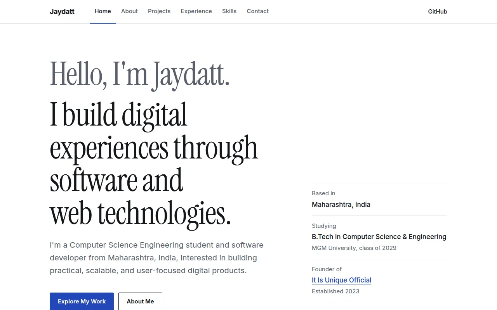

# Jaydatt Khodave – Portfolio

Personal portfolio of Jaydatt Khodave, a Computer Science Engineering student and software
developer from Maharashtra, India. Built with Jekyll and deployed on Cloudflare Pages.

**Live site:** https://jaydatt.pages.dev



## Features

- Multi-page site: Home, About, Projects, project detail pages, Experience, Skills, Education,
  Contact, and a custom 404 page.
- Content driven by Jekyll data files. Adding a project to `_data/projects.yml` generates its
  card, detail page, sitemap entry, and structured data with no template changes.
- Light, typography-focused design with a central token file, mobile-first responsive layout, and
  no frontend framework.
- Technical SEO: unique titles and descriptions, canonical URLs, Open Graph and Twitter Card
  metadata, JSON-LD (Person, WebSite, ProfilePage, CreativeWork, BreadcrumbList), sitemap, and
  `robots.txt`.
- Accessibility: semantic HTML, skip link, keyboard-operable menu, visible focus, and
  `prefers-reduced-motion` support. The site works without JavaScript.
- Self-hosted fonts, about 3.5 KB of JavaScript, and about 17 KB of CSS.

## Technology stack

| Area | Tools |
| --- | --- |
| Static site generator | Jekyll 4.4, Liquid |
| Language | Ruby 3.3, HTML5, SCSS, vanilla JavaScript |
| Plugins | `jekyll-sitemap`, a small local generator in `_plugins/` |
| Fonts | Inter and Instrument Serif (self-hosted) |
| Hosting | Cloudflare Pages through GitHub |
| CI | GitHub Actions (build validation only) |

## Repository structure

```
_config.yml  Gemfile  Gemfile.lock  .ruby-version  _headers  robots.txt  404.html
index.html  about.md  experience.md  skills.md  education.md  contact.md
projects/index.html
_data/       navigation, projects, skills, interests, experience, education
_includes/   head, structured-data, schema-person, header, footer, breadcrumbs, hero,
             project-card, timeline-entry, contact-cta
_layouts/    default, page, project
_plugins/    project_pages.rb
_sass/       variables, base, layout, components, responsive
assets/      css/main.scss, js/main.js, fonts/, images/
.github/     workflows/jekyll-build.yml, issue templates, pull request template
```

`sitemap.xml` is generated by `jekyll-sitemap`. `robots.txt` is templated from `canonical_url`.

## Local development

Requires Ruby 3.3.x (see `.ruby-version`) and [Bundler](https://bundler.io/).

```bash
git clone https://github.com/iamjaydatt2006/portfolio-2006.git
cd portfolio-2006
bundle install
bundle exec jekyll serve      # http://localhost:4000, rebuilds on change
```

Restart `jekyll serve` after editing `_config.yml` or anything in `_plugins/`.

Production build, written to `_site/`:

```bash
JEKYLL_ENV=production bundle exec jekyll build
```

## Customization

| What | Where |
| --- | --- |
| Name, email, location, social links, organization, availability, SEO defaults | `_config.yml` |
| Navigation (header and footer) | `_data/navigation.yml` |
| Projects and their detail pages | `_data/projects.yml` |
| Skills | `_data/skills.yml` |
| Technical interests (home page) | `_data/interests.yml` |
| Experience and education | `_data/experience.yml`, `_data/education.yml` |
| Page text | `index.html`, `about.md`, `experience.md`, `skills.md`, `education.md`, `contact.md` |
| Colors, type scale, spacing, widths | `_sass/_variables.scss` |

**Adding a project.** Add an entry to `_data/projects.yml`. Required fields are `slug`, `name`,
`category`, and `summary`. Optional fields include `featured`, `year`, `overview`, `problem`,
`solution`, `features`, `technologies`, `development`, `url`, `repo`, `image` (with `image_alt`,
`image_width`, `image_height`), and `screenshots`. Empty fields are hidden. A category filter
appears on the Projects page once there are six or more projects.

**Resume.** Put a file at `assets/resume.pdf` and a Resume button appears in the header. The
path is set by `resume_path` in `_config.yml`.

## Deploy to Cloudflare Pages

Cloudflare Pages deploys production from this repository through its Git integration. GitHub
Actions only validates the build. See the
[Cloudflare Jekyll guide](https://developers.cloudflare.com/pages/framework-guides/deploy-a-jekyll-site/).

1. In the Cloudflare dashboard, go to Workers & Pages > Create > Pages > Import an existing Git
   repository, and select `portfolio-2006`.
2. Use these build settings:

   | Setting | Value |
   | --- | --- |
   | Framework preset | Jekyll |
   | Production branch | `main` |
   | Build command | `bundle exec jekyll build` |
   | Build output directory | `_site` |

3. Add these environment variables for both production and preview:

   | Variable | Value |
   | --- | --- |
   | `RUBY_VERSION` | `3.3.8` |
   | `JEKYLL_ENV` | `production` |

4. Save and deploy. Pull requests get preview deployments automatically.

Canonical URLs, Open Graph URLs, the sitemap, and structured data use `canonical_url` and `url`
in `_config.yml`. If you add a custom domain, update both values. No Cloudflare tokens or other
secrets are stored in this repository.

## Continuous integration

`.github/workflows/jekyll-build.yml` runs on pushes to `main` and on pull requests that target
`main`. It builds the site with the pinned Ruby version and checks that the key pages, every
project page, the sitemap, and the canonical URLs are present in `_site/`. It does not deploy.

## Contributing

This is a personal site, but bug reports and suggestions are welcome through
[issues](https://github.com/iamjaydatt2006/portfolio-2006/issues). Commit messages follow
conventional prefixes such as `feat:`, `fix:`, `docs:`, `style:`, `refactor:`, `perf:`, and
`chore:`.

## License

The source code is released under the [MIT License](LICENSE). Project thumbnails in
`assets/images/projects/` are screenshots of third-party websites and remain the property of
their respective owners.
